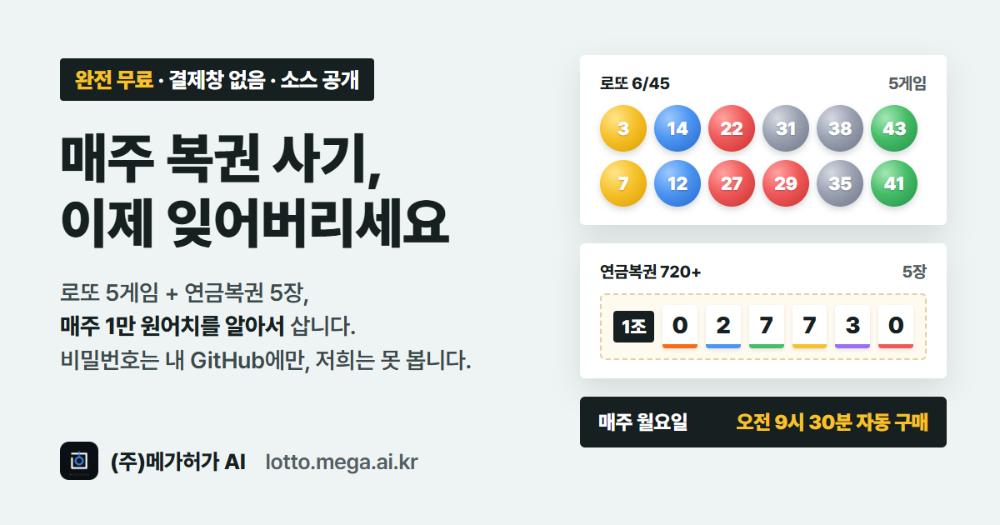
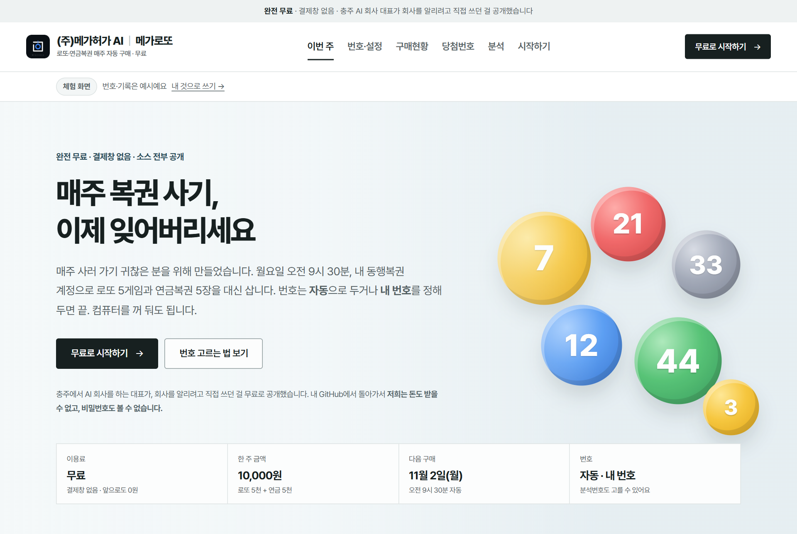
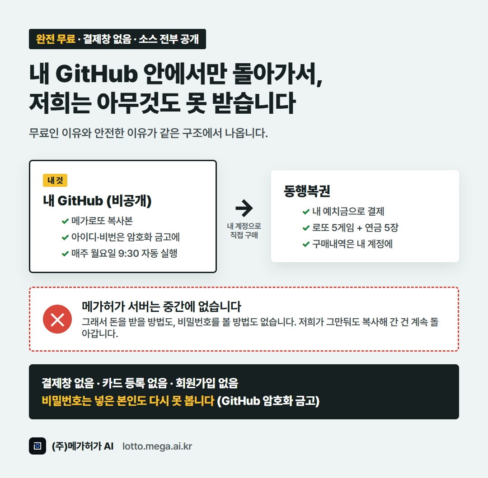
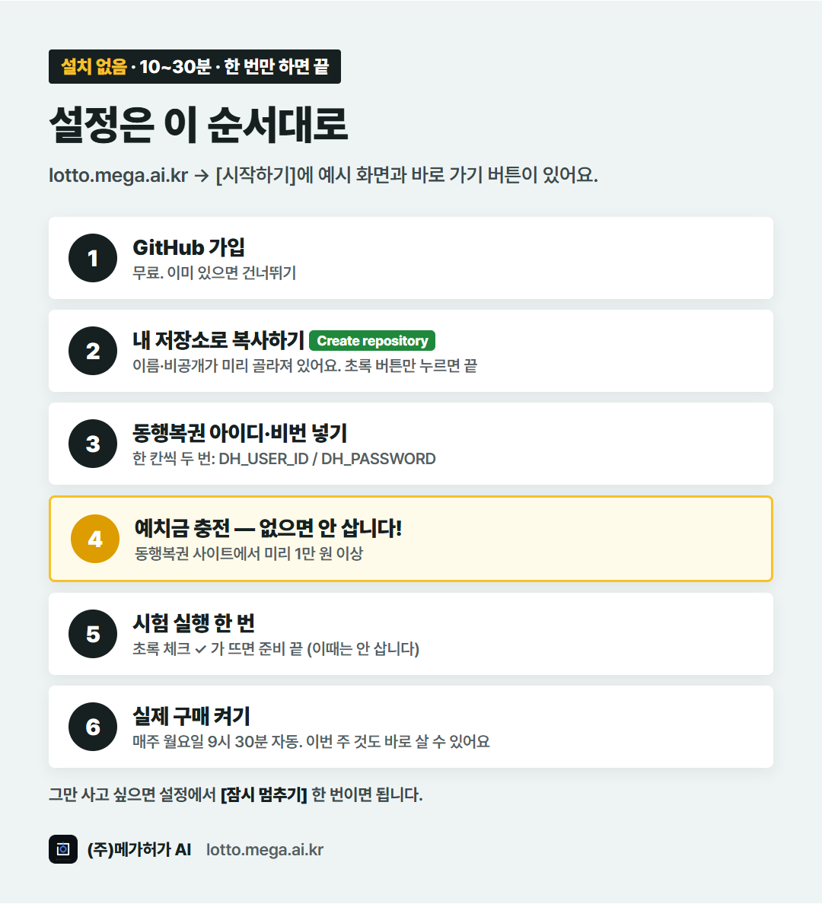

<p align="center"></p>

# 메가로또 · 메가연금

**완전 무료 · 결제창 없음 · 소스 전부 공개** — 충주에서 AI 회사를 하는 대표가, 회사를 알리려고 직접 쓰던 걸 공개했습니다.

매주 **월요일 오전 9시 30분**, 내 동행복권 계정으로 **로또 5게임 + 연금복권 5장(한 주 1만 원)** 을 알아서 삽니다.
프로그램 설치가 없고, 컴퓨터를 꺼 둬도 됩니다. 내 GitHub가 정해진 시간에 대신 실행합니다.

> 👉 **GitHub가 처음이시면 [lotto.mega.ai.kr](https://lotto.mega.ai.kr) → [시작하기]를 따라 하세요.**
> 예시 화면과 바로 가기 버튼이 있어서, GitHub를 처음 들어 본 분도 30분 안에 끝냈습니다.

> ⚠️ **쓰기 전에 꼭 읽어 주세요 — 동행복권 이용약관**
> 동행복권 사이트 이용약관 제12조는 회사가 정한 방법이 아닌 **비정상적인 방법의 서비스 이용**(1호)과 **특정 기능을 반복적·규칙적으로 호출하는 행위**(9호)를 금지하고, 어기면 **이용 제한·이용계약 해지**를 할 수 있다고 정하고 있습니다(제12조②·제13조).
> 정해진 시간에 자동으로 로그인해 사는 이 프로그램은 여기에 해당한다고 볼 수 있어, **내 동행복권 계정이 정지될 수 있습니다.**
> 메가로또는 구매대행이나 유료 서비스가 아니라, 개인적으로 쓰던 자동구매 프로그램의 소스를 무료로 공개한 것입니다. 쓸지 말지와 그 결과는 이용자 본인이 판단하고 책임집니다.

<p align="center"><a href="https://github.com/new?template_owner=megahuga&template_name=megalotto&name=my-megalotto&visibility=private"><b>▶ 내 저장소로 복사하기 (비공개로 자동 선택)</b></a></p>

## 이런 화면에서 봅니다

<p align="center"></p>

- 이번 주 번호 · 당첨번호 조회 · 분석 리포트 · 구매현황 · 설정을 한 화면에서, 휴대폰에서도 봅니다
- 번호 방식은 게임마다 고릅니다: **분석번호 · 저장번호(내가 정한 번호) · 무작위 · 동행복권 자동**
- 로또 게임 수 줄이기, 연금복권 끄기도 됩니다

## 왜 무료고, 비밀번호는 안전한가요

<p align="center"></p>

- 각자 **내 GitHub(비공개 저장소)** 에 복사해서 **그 안에서만** 돌아갑니다. 저희 서버를 거치지 않습니다.
- 그래서 저희는 **돈을 받을 방법도, 비밀번호를 볼 방법도 없습니다.** 나중에 유료가 될 수도 없는 구조입니다.
- 동행복권 아이디·비밀번호는 GitHub **비밀 보관함(Secrets)** 에 암호화돼 들어갑니다. 넣은 본인도 다시 못 보고, 실행 기록에도 `***`로 가려집니다.
- GitHub 무료 계정으로 충분합니다. 한 달 실행 시간 30~60분(무료 한도 2,000분). 복권 값만 동행복권 예치금에서 나갑니다.

## 설정 순서 (10~30분, 한 번만)

<p align="center"></p>

1. **GitHub 가입** — 무료. 이미 있으면 건너뛰기
2. **[내 저장소로 복사하기](https://github.com/new?template_owner=megahuga&template_name=megalotto&name=my-megalotto&visibility=private)** — 이름과 비공개(Private)가 미리 골라져 있어요. 초록색 **Create repository**만 누르면 됩니다
3. **동행복권 아이디·비밀번호 넣기** — 내 저장소 **Settings → Secrets and variables → Actions → New repository secret**에서 한 칸씩 두 번

   | Name | Secret |
   |---|---|
   | `DH_USER_ID` | 동행복권 아이디 |
   | `DH_PASSWORD` | 동행복권 비밀번호 |

4. **예치금 충전** — 동행복권 사이트에서 미리 1만 원 이상. **예치금이 없으면 사지 않습니다**
5. **시험 실행 한 번** — 내 저장소 **Actions → 메가로또·메가연금 → Run workflow** → 할 일을 `buy`로 → 초록색 **Run workflow**. 처음엔 시험 모드라 로그인·잔액·번호까지만 확인하고 사지 않습니다. 초록 체크 ✓가 뜨면 준비 끝
6. **실제 구매 켜기** — [lotto.mega.ai.kr](https://lotto.mega.ai.kr) **설정 → 내 저장소 연결** 후 **자동으로 사기**를 고르고 저장. 이번 주 것을 아직 안 샀다면 저장하자마자 바로 사게 할 수도 있어요

<details>
<summary>내 저장소 연결에 필요한 토큰 만드는 법</summary>

GitHub **Settings → Developer settings → Fine-grained tokens → Generate new token**

- Repository access: **Only select repositories** → 내 메가로또 저장소 하나만
- Permissions: **Contents** 읽기/쓰기, **Actions** 읽기/쓰기

토큰은 그 브라우저에만 저장되고 GitHub 말고 다른 곳으로 보내지 않습니다.
(선택) 텔레그램으로 결과를 받으려면 Secrets에 `TELEGRAM_BOT_TOKEN`, `TELEGRAM_CHAT_ID`도 넣으세요. 넣지 않아도 실패하면 GitHub가 메일로 알려 줍니다.
</details>

## ✋ 그만 사고 싶으면

1. **가장 쉬움:** 대시보드 **번호·설정**에서 **잠시 멈추기** → 저장. 당첨번호 확인은 계속합니다.
2. **GitHub에서 통째로 끄기:** 내 저장소 `Actions` → 왼쪽 `메가로또·메가연금` → 오른쪽 위 `⋯` → `Disable workflow` (다시 켜려면 `Enable workflow`)
3. **완전히 그만두기:** 내 저장소 `Settings` 맨 아래 `Delete this repository`. 남은 예치금은 동행복권에서 출금하세요.

이미 산 복권은 어떤 방법으로도 취소할 수 없습니다(동행복권 규정).

## 자동 일정 (한국 시간)

| 언제 | 하는 일 |
|---|---|
| 일요일 07:00 | 로또 당첨번호 반영 → 이번 주 분석번호 생성 → 지난주 당첨 확인 → 잔액 확인 |
| 월요일 09:30 | 이번 주 로또 + 연금복권 구매 |
| 목요일 20:30 | 연금복권 당첨번호 반영 → 당첨 확인 → 잔액 확인 |

같은 주에 이미 산 상품(사이트에서 직접 산 것 포함)은 다시 사지 않습니다. 예치금이 모자라면 사지 않고 알려 줍니다.
GitHub 예약 실행은 몇 분~수십 분 늦게 시작될 수 있습니다.

## 번호 방식

| 방식 | 설명 |
|---|---|
| 분석번호 | 1회부터 최신 회차까지 분석해 매주 5게임을 뽑습니다. 최근 흐름·반등 기대·번호대 균형·이월·이웃수·종합 다섯 가지 기준, 합계 100~175·홀짝/고저 2:4~4:2·AC 7 이상·3연번 제외·역대 1등 조합 제외. 같은 회차에는 늘 같은 번호가 나옵니다. |
| 저장번호 | 대시보드에서 고른 번호(최대 5개)를 매주 삽니다. |
| 무작위 | 구매할 때 새로 뽑습니다. |
| 자동 | 동행복권 자동번호로 삽니다. |

연금복권은 1~5조 같은 번호 세트(자동·분석·저장번호) 또는 조마다 다른 자동번호 5장 중에 고릅니다.

## 알아 둘 것

- **당첨 확률을 올려 주는 프로그램이 아닙니다.** 복권은 매 회차 독립시행이라 어떤 번호든 확률이 같습니다. "사러 가는 귀찮음"을 없애 주는 프로그램입니다.
- 인터넷 구매는 만 19세 이상. 한도: 로또는 한 회차 1인당 5천 원, 연금복권은 하루 15만 원(동행복권 안내 기준). 이 프로그램은 한 주 최대 1만 원만 삽니다.
- 예치금 충전은 자동으로 하지 않습니다. 보안 키패드를 뚫는 방식은 쓰지 않습니다.
- 동행복권 사이트가 바뀌면 구매가 실패할 수 있습니다. 실패하면 사지 않고 알립니다.
- GitHub 서버는 해외에 있습니다. 동행복권이 접속을 막으면 실행 기록에 "접속을 막았습니다"가 뜹니다.
- 연금복권은 번호마다 한 장뿐이라, 저장번호로 고른 번호가 이미 팔렸으면 그 주 연금 구매가 실패할 수 있습니다.
- 자동 구매는 동행복권 이용약관 제12조 1·9호에 해당할 수 있어 계정 이용 제한·해지 사유가 될 수 있습니다(맨 위 안내 참고). 걱정되면 자동 구매는 끄고(잠시 멈추기) 번호 추천·당첨 확인만 쓰셔도 됩니다.

> 추첨은 무작위이며 당첨을 보장하지 않습니다. 구매 결과에 대한 책임은 사용자에게 있습니다.
> 메가로또는 동행복권과 관계없는 비공식 프로그램입니다.

## 개발

```bash
npm install
npm test                    # 테스트
node src/cli.js update      # 당첨번호 받기 + 분석
DH_USER_ID=... DH_PASSWORD=... node src/cli.js buy   # config/settings.json의 dryRun이 true면 시험만
npm run dashboard           # 대시보드 (http://localhost:5178/dashboard/)
```

| 파일 | 하는 일 |
|---|---|
| `src/draws.js` | 공개 당첨번호 받기(로그인 없음) |
| `src/analyze.js` | 분석·분석번호·등수 계산(대시보드와 같이 씀) |
| `src/picks.js` | 설정 → 이번 주 살 번호 |
| `src/dhlottery.js` | 로그인·잔액·구매·구매내역 (사이트가 바뀌면 여기만 고치면 됨) |
| `src/cli.js` | 실행기 |
| `dashboard/` | 대시보드(빌드 없음) |
| `config/settings.json` | 내 설정(대시보드가 고침) |
| `data/` | 당첨번호·분석·구매 기록(Actions가 커밋) |

동행복권 화면 구조는 공개된 비공식 프로젝트들(특히 [roeniss/dhlottery-api](https://github.com/roeniss/dhlottery-api), Apache-2.0)을 참고해 새로 작성했습니다.

## 만든 회사

**(주)메가허가 AI** — 충주·서충주의 AI·AX 회사입니다. 매주 반복되는 일을 사람 대신 정확하게 처리하는 프로그램을 만들고 운영합니다.

- [mega.ai.kr](https://mega.ai.kr) · 업무 자동화, AI 검색 홈페이지
- [모두의 안전안내](https://safe.mega.ai.kr) · 공공기관 현장에서 쓰고 있는 매일 안전 브리핑
- 문의: contact@mega.ai.kr

써 보시고 괜찮으면 오른쪽 위 **⭐ Star** 하나 눌러 주세요. 큰 힘이 됩니다.

## 라이선스

MIT · (주)메가허가에이아이
